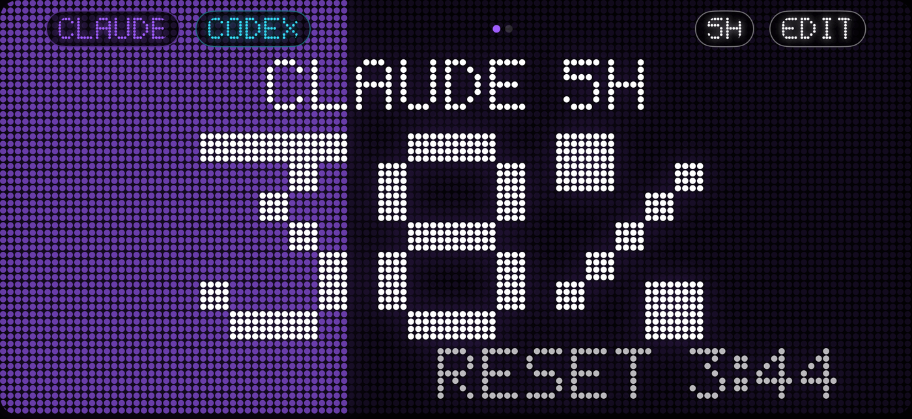

<p align="center"></p>

<h1 align="center">TokenBar</h1>

<p align="center">
Your <b>Claude Code</b>, <b>Codex</b>, <b>Copilot</b>, <b>Windsurf</b>, <b>Cursor</b>, <b>Gemini</b>, <b>Kiro</b>, <b>GLM</b>, <b>Kimi</b>, <b>Amp</b>… (or any AI) usage limits and when they reset,<br>
on an LED display everywhere: Mac, Windows, Linux, iPhone, Android, Apple Watch and Wear OS.
</p>

<p align="center"></p>

[](https://m8ven.ai/mcp/chaconlucas-tokenbar-1xqj8l?s=readme)
[](https://www.bestpractices.dev/projects/15656)

[](https://github.com/ChaconLucas/tokenbar/releases)
[](https://github.com/ChaconLucas/tokenbar/blob/main/LICENSE)
[](https://github.com/ChaconLucas/tokenbar/stargazers)

**English** · [Português](README.pt-BR.md)


**Website & API docs:** https://chaconlucas.github.io/tokenbar/

---

## Install

**The computer collects the numbers.** Phones and watches only show what it sends over Wi-Fi, so always start there.

| | Device | How |
|---|---|---|
| **Computer** | **Mac** (macOS 15+) | `curl -fsSL https://raw.githubusercontent.com/ChaconLucas/tokenbar/main/scripts/install-mac.sh \| sh` |
| | Mac via Homebrew | `brew install --cask chaconlucas/tokenbar/tokenbar` |
| | **Windows** 10/11 | `TokenBar-Windows-setup.exe` from [Releases](https://github.com/ChaconLucas/tokenbar/releases). SmartScreen warns? **More info → Run anyway** |
| | Windows via winget | `winget install ChaconLucas.TokenBar` (pending Microsoft review) |
| | **Linux** | build from source, see [Build from source](#build-from-source) |
| **Phone & watch** | **iPhone** (iOS 17+) | on a Mac with Xcode, iPhone plugged in: `curl -fsSL https://raw.githubusercontent.com/ChaconLucas/tokenbar/main/scripts/install-ios.sh \| sh`. Add `-s -- --auto` after `sh` and the Mac renews and updates it by itself |
| | Apple Watch (watchOS 10+) | comes with the iPhone app: iPhone → **Watch** app → TokenBar → Install |
| | **Android** 8+ | `TokenBar-Android.apk` from [Releases](https://github.com/ChaconLucas/tokenbar/releases) (allow "install unknown apps") |
| | Wear OS 3+ | `TokenBar-WearOS.apk` from Releases, installed with `adb` ([steps](INSTALL.md#wear-os-watch-galaxy-watch-pixel-watch)) |
| **Extras** | VS Code | search **TokenBar** in Extensions ([Marketplace](https://marketplace.visualstudio.com/items?itemName=chaconlucas.tokenbar), id `chaconlucas.tokenbar`) |
| | Raycast | from source: `cd raycast && npm install && npm run dev` ([details](raycast/README.md)) |
| | Stream Deck | `TokenBar-StreamDeck.streamDeckPlugin` from Releases, double-click it ([details](streamdeck/README.md)) |
| | Plugins | Claude Code: `claude plugin marketplace add ChaconLucas/tokenbar && claude plugin install tokenbar@tokenbar`. Codex and Gemini CLI: [Plugins](docs/api.md#plugins) (MCP server, `/tokenbar`, warning at 80%) |
| | CLI + MCP | `curl -fsSL https://raw.githubusercontent.com/ChaconLucas/tokenbar/main/scripts/install-cli.sh \| sh` (Node 18+). Claude Desktop: `TokenBar.mcpb` from Releases, double-click it. Cursor, VS Code, Windsurf, Zed, Gemini, Goose…: [Install in your AI](docs/api.md#install-in-your-ai) (one click, or `--add-to <tool>`) |

**Updates:** Mac, Windows and Android show an update button inside the app. The iPhone (and its watch app) updates by running `install-ios.sh` again, or automatically with `--auto`. VS Code updates through the Marketplace.

<details>
<summary><b>Mac blocked it ("can't be opened", "unidentified developer", "is damaged")?</b></summary>

TokenBar isn't notarized by Apple yet (that needs a paid developer account), so macOS blocks the first launch when the app comes **from a browser**. Any of these fixes it:

1. **Install with the command above.** Downloaded from Terminal, the warning doesn't appear.
2. **Allow it once:** try to open TokenBar → **System Settings → Privacy & Security** → scroll down → **Open Anyway** → your Mac password.
3. **"Is damaged"?** In Terminal: `xattr -dr com.apple.quarantine /Applications/TokenBar.app` and open it again.

The prompt *"TokenBar wants to use confidential information stored in Claude Code-credentials"* isn't a block: it's the login reading (VS Code panel). Choose **Always Allow**.
</details>

**Or ask your AI.** Open Claude Code, Codex or any AI with a terminal and say:

> Read https://github.com/ChaconLucas/tokenbar/blob/main/INSTALL.md and install TokenBar for me.

[`INSTALL.md`](INSTALL.md) is written for the AI: it asks which devices you have, runs the commands, and only asks for your hands when needed (a permission, the phone, the watch).

---

## What it does

**Mac**
- An LED **device** window (bigger, smaller or full screen) and a floating **Mini** that stays on top of everything, full-screen apps included.
- **MOSTRAR A %** (show the %): **BARRA** (little LED bars with the % in the menu bar), **NOTCH** (a black pill around the camera, hover to open) or **OS DOIS** (both).
- Clicking the menu bar opens a summary with glass buttons (*liquid glass* on macOS 26): device, Mini, **Ajustes** (settings), refresh, quit.
- Widgets (small, medium, large) and **Control Center** controls (macOS 26): TokenBar, Claude, Codex, floating and device.
- **Ajustes** in four tabs: **GERAL** (language, what to show, colors), **IAS** (AIs), **APARELHOS** (phones and watches), **SERVIDOR** (local API, webhook, server). A **Primeiros passos** (getting started) guide connects everything step by step.

**Windows and Linux** — the same LED device, the floating Mini, a 12-dot ring in the system tray and the getting-started guide (app in [`desktop/`](desktop), built with Tauri).

**iPhone**
- Opens in landscape, full screen, screen always on: a desk clock for your limits.
- Widgets on the Home Screen and Lock Screen (presets plus a custom one; "one at a time" switches AI on tap).
- **Live Activity** on the Lock Screen and in the **Dynamic Island** (on iPhones that have one), with buttons to switch AI and window.
- Built-in QR scanner (**ESCANEAR QR**) to pair with the computer, and a notice when an update is out or the free-account app is about to expire.

**Apple Watch** — app (TODOS / CLAUDE / CODEX, 5H / 7D, or turn the Digital Crown), watch-face complications, and a **Smart Stack** card (the Live Activity on watchOS 11+, plus widgets that rise when a limit is close or about to reset).

**Android and Wear OS** — phone in landscape with a home-screen widget, alerts and in-app updates. The Wear OS watch works **with or without the phone**: alone, type the 6-digit code from the computer (Mac: **Ajustes → APARELHOS → WEAR OS SEM CELULAR**). Complications on the watch face. Huawei without Google services: the QR scan doesn't work, paste the link instead.

<p align="center">


</p>

**AIs**
- **Claude Code** through the terminal statusline (one click: **CONECTAR** in **Ajustes → IAS**), or through its login when you use the **VS Code panel**.
- **Codex**: automatic, from the terminal, VS Code or the Codex app.
- **GitHub Copilot**: opt-in (monthly premium requests, via `gh auth token`).
- **Windsurf**: automatic.
- **Cursor, Gemini CLI, Kiro**: opt-in, using the login each one already saved (Gemini: Workspace / Code Assist accounts only).
- **GLM (Z.ai), MiniMax, Kimi Code, OpenRouter, Factory Droid, Amp**: paste an API key in **Settings → AIs** (Mac: stored in the Keychain).
- **Any other AI** through a small JSON file: [docs/providers.md](docs/providers.md).

**Everything else**
- **Languages:** Portuguese and English, with an **AUTO / PT / EN** switch (AUTO follows the system).
- **Windows:** 5 hours, 7 days, or both on the same screen. The background fills with usage: 23% lights 23% of the display.
- **Alerts** when a window passes **80%** and **95%** and when it **resets** (the iPhone mirrors them to the watch).
- **Customization:** a color per AI, text and timer colors, color by usage, red from 85%, round or square dots, brightness.

<p align="center">


</p>
<p align="center"></p>
<p align="center">


</p>
<p align="center"></p>
<p align="center">


</p>
<p align="center"></p>
<p align="center"></p>
<p align="center">


</p>

---

## API & developers

- **Local API** while the app runs (Mac, Windows, Linux): `http://localhost:41777/v1/usage`, localhost only; real port in `~/.tokenbar/api.json`.
- **CLI** `tokenbar`: bars in the terminal, `tokenbar --prompt` for the shell prompt or tmux, `tokenbar get claude 5h` for scripts. Works without the app too.
- **MCP server** `tokenbar-mcp`: Claude Code, Codex or Cursor call `check_budget` before a long task.
- **Webhooks** at 80% / 95% / reset (Slack and Discord get a sentence; anything else gets the JSON).
- `~/.tokenbar/snapshot.json` to read without the app, and `~/.tokenbar/providers/*.json` to add any AI.

```sh
curl -s http://localhost:41777/v1/usage
```

Schemas and examples (curl, JavaScript, Python, starship, tmux, zsh): [docs/api.md](docs/api.md).

---

## How it works

```
                          Wi-Fi (Bonjour)                       WatchConnectivity / Wear OS
 Computer ─────────────────────────────────────► iPhone / Android ─────────────────────► Apple Watch / Wear OS
 (Mac, Windows, Linux)                             widgets, Lock Screen,                  complications
  │ Claude Code: copy of the statusline (or login)  Live Activity
  │ Codex: ~/.codex/sessions · Windsurf · Copilot · Cursor · Gemini · Kiro · GLM · MiniMax · Kimi · OpenRouter · Droid · Amp
  │ any AI: ~/.tokenbar/providers/*.json
  │
  └──── PUT ────► server (optional) ◄── GET ──── phones and watches, away from home
```

1. **The computer collects.** Claude Code only hands its limits to the *statusline*; TokenBar installs a small script (`~/.tokenbar/claude-tee.sh`) that saves a copy and runs the statusline you already had, unchanged (with a backup of `settings.json`). Codex writes its limits into `~/.codex/sessions`.
2. **It advertises on the local network** (`_tokenbar._tcp`) and only answers devices holding the pairing key.
3. **Phones find it on their own** on the same Wi-Fi and pass the numbers to the watch.
4. **Optional server:** the computer also sends to it, and phones use the newest number between Wi-Fi and server.

## Privacy

- **No code, prompt or conversation leaves the computer.** Only percentages, reset times and how long ago they were read.
- **Wi-Fi:** the computer only answers devices that send the pairing key; the advertisement shows only its first 8 characters.
- **Local API:** listens on 127.0.0.1 only and rejects other `Host` headers.
- **Logins:** the Claude Code login token only goes to Anthropic; the GitHub token (Copilot) only goes to GitHub. Both are read-only and off by default.
- **Server:** stores the `sha256` of the key, never the key, and the latest snapshot.
- **Anyone with the QR code can see your numbers.** Don't post it.

## Known limitations

- **iPhone needs a Mac with Xcode**, and with a free Apple account the app expires every **7 days** (renew with `install-ios.sh`, or `--auto`).
- **macOS:** not notarized (see the "Mac blocked it?" box). Not sandboxed, so no Mac App Store.
- **Linux:** no package yet; build from source.
- **Claude Code:** numbers update while a Claude Code session is running (statusline), unless login reading is on.
- **Unofficial endpoints:** Claude login reading and Copilot use endpoints that aren't publicly documented and may change.
- **Widgets:** iOS and watchOS refresh them roughly every 15 minutes.

## Troubleshooting

| Symptom | What to do |
|---|---|
| Phone: "Mac não encontrado no Wi-Fi" (Mac not found) | Same Wi-Fi? iPhone: **Local Network** on (Settings → Privacy & Security → Local Network → TokenBar)? Computer firewall allowing TokenBar? |
| Phone: "O Mac recusou a chave" (key refused) | Scan the QR again. |
| Claude doesn't show up | **Ajustes → IAS → CLAUDE CODE → CONECTAR**, then send a message in Claude Code in the terminal. |
| Claude in the **VS Code panel** | The statusline doesn't run there. Turn on **PAINEL DO VS CODE** in **Ajustes → IAS**, or click **LIGAR** on the hint under the device. macOS asks once: Always Allow. |
| Codex doesn't show up | Use Codex once; the limits arrive with the first reply. |
| VS Code extension in Restricted Mode | No longer an issue: the extension runs in untrusted workspaces. |
| Watch: "integrity could not be verified" | Turn on Developer Mode on the watch (Settings → Privacy & Security). |
| Blank icon in the Dock | `killall Dock`. If it persists, restart the Mac. |

---

## Build from source

**Mac, iPhone and Apple Watch** (Xcode 26+ and `brew install xcodegen`):

```sh
git clone https://github.com/ChaconLucas/tokenbar.git && cd tokenbar
printf 'DEVELOPMENT_TEAM = ABCDE12345\nTB_BUNDLE_PREFIX = com.yourname\n' > Config/Signing.local.xcconfig   # your Team ID; git ignores this file
xcodegen generate && open TokenBar.xcodeproj
```

Schemes: **TokenBarMac** (Mac), **TokenBar** (iPhone, brings the watch app), **TokenBarWatch**. iPhone and watch need **Developer Mode**; on first launch allow **Local Network**, then pair with the QR in **Ajustes → APARELHOS**.

**Windows and Linux** (Rust and Node 18+; Linux also `sudo apt install libwebkit2gtk-4.1-dev libayatana-appindicator3-dev librsvg2-dev build-essential`):

```sh
cd desktop && npm install && npx tauri build    # installers in src-tauri/target/release/bundle/
```

**Android and Wear OS** (JDK 17 and the Android SDK):

```sh
cd android
echo "sdk.dir=$HOME/Library/Android/sdk" > local.properties
JAVA_HOME=/opt/homebrew/opt/openjdk@17 ./gradlew :app:assembleDebug :wear:assembleDebug
adb install app/build/outputs/apk/debug/app-debug.apk                # phone
adb -s <watch> install wear/build/outputs/apk/debug/wear-debug.apk   # watch
```

### Optional server (see your numbers away from home)

Without a server, phones only update on the same Wi-Fi as the computer. Deploy your own, free, on Cloudflare (Worker + D1):

```sh
cd server && npm install && cp wrangler.example.toml wrangler.toml
npx wrangler login
npx wrangler d1 create tokenbar          # copy the database_id into wrangler.toml
npx wrangler d1 execute tokenbar --remote --file=schema.sql
npx wrangler deploy                      # prints https://tokenbar.<your-account>.workers.dev
```

Paste the address in **Ajustes → SERVIDOR → ENDEREÇO** (Windows/Linux: ⚙) and scan the QR again on the phone. The computer only sends when the number changes, or every 10 minutes.

## Structure

```
App/macOS    Mac app: collector, Wi-Fi server, notch island, Mini, settings, local API, webhooks
App/iOS      iPhone app: full screen, Live Activity, guide and QR scanner
App/watchOS  Apple Watch app
Shared/      model, LED display, theme, languages, Wi-Fi client, server API
Widget/      widgets, complications, Control Center and Live Activity (Mac, iPhone, Watch)
android/     Android phone (app), Wear OS (wear) and shared code (core)
desktop/     Windows and Linux app (Tauri)
vscode/      VS Code extension
raycast/     Raycast extension
streamdeck/  Stream Deck plugin
cli/         `tokenbar` CLI and `tokenbar-mcp` server
server/      optional Cloudflare Worker + D1
scripts/     installers (Mac, iPhone, CLI) and release
docs/        images, API and providers docs
```

## License

MIT. See [LICENSE](LICENSE).

TokenBar is an independent project and is not affiliated with Anthropic, OpenAI, GitHub or the makers of Windsurf. "Claude", "Claude Code", "Codex", "Copilot" and "Windsurf" are trademarks of their respective owners.
