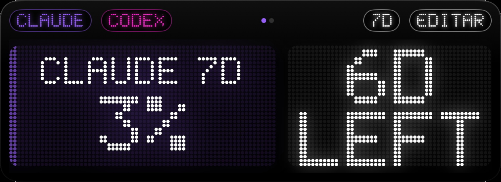

<p align="center"></p>

<h1 align="center">TokenBar</h1>

<p align="center">
Quanto você já gastou dos limites do <b>Claude Code</b> e do <b>Codex</b>, e quando reseta,<br>
num display de LED no Mac, no iPhone e no Apple Watch.
</p>

<p align="center"></p>

> **English summary:** TokenBar shows how much of your Claude Code and Codex usage limits (5‑hour and weekly windows) you have used, and when they reset, on a dot‑matrix LED display for Mac (window, menu bar, widgets), iPhone (full‑screen landscape app, widgets, lock screen) and Apple Watch (app and complications). The Mac reads the numbers locally; the iPhone finds the Mac on your Wi‑Fi (Bonjour) — no account, no server. An optional free Cloudflare Worker lets you see your numbers away from home. Build instructions below are in Portuguese but the steps are the commands themselves.

---

## O que ele faz

- **Mac:** um "aparelho" de LED na tela (dá para aumentar, diminuir e pôr em tela cheia), a % na barra de menu e widgets.
- **iPhone:** abre deitado, em tela cheia, com a tela sempre acesa, para usar como relógio de mesa. Tem widgets na tela inicial e na tela bloqueada.
- **Apple Watch:** um app e complicações no mostrador (anel, canto e linha).
- **Duas IAs:** Claude Code e Codex. Você escolhe qual aparecer e arrasta para o lado para trocar.
- **Janelas:** 5 horas, 7 dias ou as duas na mesma tela.
- **Personalização:** cor de cada IA, do texto e do tempo, pontos redondos ou quadrados, brilho e vermelho perto do limite.
- **O fundo enche conforme o gasto:** 23% acende 23% do display.

<p align="center">


</p>

## Como funciona

```
                    Wi-Fi (Bonjour)                    WatchConnectivity
 Mac ─────────────────────────────────────► iPhone ─────────────────────► Apple Watch
  │ lê os limites do disco                    │ widgets e tela bloqueada     complicações
  │ Claude Code: cópia da statusline          │
  │ Codex: ~/.codex/sessions                  │
  │                                           │
  └──── PUT ────► servidor (opcional) ◄── GET ┘   fora de casa
```

1. **O Mac coleta.** O Claude Code entrega os limites (`rate_limits.five_hour` e `seven_day`) só para a *statusline*. O app instala um pequeno script (`~/.tokenbar/claude-tee.sh`) que guarda uma cópia desse JSON e repassa para a statusline que você já tinha, sem mudar nada que você vê no terminal. O Codex grava os limites nos arquivos de sessão em `~/.codex/sessions`.
2. **O Mac anuncia na rede local** (`_tokenbar._tcp`) e responde só para quem tem a chave do pareamento.
3. **O iPhone acha o Mac sozinho** no mesmo Wi-Fi, lê os números e passa para o relógio.
4. **Servidor opcional:** se você configurar um, o Mac também envia para ele, e o iPhone usa o número mais recente entre Wi-Fi e servidor. Assim funciona fora de casa.

## Requisitos

- macOS 15+ com **Xcode 26+**
- [XcodeGen](https://github.com/yonaskolb/XcodeGen): `brew install xcodegen`
- iPhone com iOS 17+ e, se quiser, Apple Watch com watchOS 10+
- Uma conta Apple (a gratuita serve para rodar nos seus próprios aparelhos)
- Claude Code e/ou Codex instalados no Mac

## Instalar

### 1. Baixar e configurar a assinatura

```sh
git clone https://github.com/ChaconLucas/tokenbar.git
cd tokenbar
```

Crie `Config/Signing.local.xcconfig` (o git ignora este arquivo) com duas linhas:

```
DEVELOPMENT_TEAM = ABCDE12345     // Xcode → Settings → Accounts → seu time → Team ID
TB_BUNDLE_PREFIX = com.seunome    // qualquer prefixo único seu
```

Gere o projeto e abra:

```sh
xcodegen generate
open TokenBar.xcodeproj
```

### 2. Mac

1. No Xcode, escolha o esquema **TokenBarMac** e rode (⌘R). O aparelho aparece na tela e a % aparece na barra de menu.
2. Clique em **EDITAR → Mais ajustes… → Conectar Claude Code**. Antes de mexer, é feito um backup em `~/.claude/settings.json.tokenbar-backup`.
3. Os números do Claude aparecem na próxima vez que uma sessão do Claude Code atualizar a statusline. Os do Codex já aparecem se você usou o Codex recentemente.

> O macOS pode perguntar se o TokenBar pode **aceitar conexões de entrada**. Responda **Permitir**: é assim que o iPhone lê o Mac pelo Wi-Fi.

Para deixar o app fixo em Aplicativos, use **Product → Archive → Distribute App → Copy App** no Xcode, ou copie `TokenBar.app` da pasta de build para `/Applications`.

### 3. iPhone

1. Conecte o iPhone e ative o **Modo de Desenvolvedor** (Ajustes → Privacidade e Segurança).
2. Escolha o esquema **TokenBar** com o seu iPhone como destino e rode. O app do relógio vai junto.
3. Na primeira abertura, **permita o acesso à Rede Local**. Sem isso o iPhone não acha o Mac.
4. No Mac, em **EDITAR → Mais ajustes…**, aponte a câmera do iPhone para o **QR code** e toque em **Abrir no TokenBar**.
5. Se o iOS disser que o desenvolvedor não é confiável: Ajustes → Geral → VPN e Gerenciamento de Dispositivos → confiar.

### 4. Apple Watch

1. No relógio: **Ajustes → Privacidade e Segurança → Modo de Desenvolvedor → ligar** (ele reinicia).
   Se a opção não aparecer, abra o Xcode em **Window → Devices and Simulators** com o relógio desbloqueado e perto do iPhone.
2. No iPhone: app **Watch → Meu Relógio → TokenBar → Instalar**.
3. O relógio recebe o pareamento e os números pelo iPhone. Não precisa configurar nada nele.

> **"Não foi possível instalar porque a integridade não pôde ser verificada"** = o Modo de Desenvolvedor está desligado no relógio, ou o relógio ainda não foi registrado no seu time. Ligue o modo e rode o esquema **TokenBarWatch** uma vez com o relógio como destino.

### 5. Widgets

- **iPhone:** segure o dedo na tela inicial ou na tela bloqueada → **+** → TokenBar.
- **Watch:** segure o mostrador → Editar → complicações → TokenBar.
- **Mac:** clique com o botão direito na mesa → Editar Widgets → TokenBar.

## Servidor opcional (ver fora de casa)

Sem servidor, o iPhone só atualiza quando está no mesmo Wi-Fi que o Mac; fora dele, mostra o último número. Para atualizar de qualquer lugar, suba o seu servidor gratuito na Cloudflare (Worker + D1):

```sh
cd server
npm install
cp wrangler.example.toml wrangler.toml
npx wrangler login
npx wrangler d1 create tokenbar          # copie o database_id que aparecer para wrangler.toml
npx wrangler d1 execute tokenbar --remote --file=schema.sql
npx wrangler deploy                      # mostra https://tokenbar.<sua-conta>.workers.dev
```

Depois, no Mac: **EDITAR → Mais ajustes… → Servidor**, cole o endereço, **SALVAR** e escaneie o QR de novo no iPhone.

O plano gratuito da Cloudflare permite 100 mil gravações por dia. O Mac só envia quando o número muda, ou a cada 10 minutos como sinal de vida.

## Privacidade

- **Nada de código, prompt ou conversa sai do Mac.** Só porcentagens, horários de reset e há quanto tempo foram lidos.
- **No Wi-Fi:** o Mac só responde a quem envia a chave do pareamento. O anúncio na rede mostra só os 8 primeiros caracteres dela, para o iPhone saber qual Mac é o seu.
- **No servidor:** ele guarda o `sha256` da chave, nunca a chave, e o último retrato de uso.
- **Quem tem o QR code vê os seus números.** Não publique.

## Limitações conhecidas

- **Claude Code:** os números só atualizam enquanto alguma sessão do Claude Code está aberta, porque é ela que alimenta a statusline. O display mostra há quanto tempo o número foi lido.
- **Widgets:** o iOS e o watchOS limitam a atualização dos widgets a mais ou menos a cada 15 minutos. Sem servidor, o widget do iPhone mostra o que o app leu da última vez que esteve aberto.
- **Depois do reset:** a barra volta a 0% sozinha, mesmo antes de chegar número novo.
- **App Store:** o app do Mac não usa sandbox (precisa ler `~/.codex` e `~/.claude`), por isso não é distribuível pela Mac App Store.

## Problemas comuns

| Sintoma | O que fazer |
|---|---|
| iPhone diz "Mac não encontrado no Wi-Fi" | Mesmo Wi-Fi? Permissão de **Rede Local** ligada (Ajustes → Privacidade → Rede Local → TokenBar)? Firewall do Mac permitindo o TokenBar? |
| iPhone diz "O Mac recusou a chave" | Escaneie o QR de novo. |
| Claude não aparece | Clique em **Conectar Claude Code** e abra uma sessão do Claude Code. Confira se existe `~/.tokenbar/claude.json`. |
| Codex não aparece | Use o Codex uma vez. Os limites aparecem nos arquivos de sessão depois da primeira resposta. |
| Relógio: "integridade não pôde ser verificada" | Veja **Instalar → Apple Watch**. |
| Ícone em branco no Dock | `killall Dock`. Se continuar, reinicie o Mac (cache de ícones do macOS). |

## Estrutura

```
App/macOS     coletor (Claude/Codex), servidor Wi-Fi (Bonjour), janela, barra de menu, ajustes
App/iOS       app em tela cheia, busca Wi-Fi + servidor, repassa ao relógio
App/watchOS   app do relógio (recebe do iPhone)
Shared/       modelo, display de matriz de pontos, tema, cliente Wi-Fi, API do servidor
Widget/       widgets e complicações (um código para Mac, iPhone e Watch)
server/       Cloudflare Worker + D1 (opcional)
Config/       assinatura (Signing.xcconfig + o seu Signing.local.xcconfig)
scripts/      gerador do ícone
```

## Licença

MIT. Veja [LICENSE](LICENSE).

TokenBar é um projeto independente e não tem ligação com a Anthropic nem com a OpenAI. "Claude", "Claude Code" e "Codex" são marcas dos seus donos.
