<p align="center">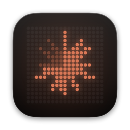</p>

<h1 align="center">TokenBar</h1>

<p align="center">
Os limites do <b>Claude Code</b>, do <b>Codex</b>, do <b>Copilot</b>, do <b>Windsurf</b>, do <b>Cursor</b>, do <b>GLM</b>, do <b>Kimi</b>… (ou de qualquer IA) e quando eles resetam,<br>
num display de LED em todo lugar: Mac, Windows, Linux, iPhone, Android, Apple Watch e Wear OS.
</p>

<p align="center">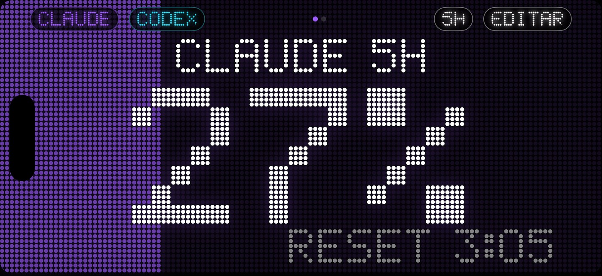</p>

[English](README.md) · **Português**


**Site e documentação da API:** https://chaconlucas.github.io/tokenbar/

---

## Instalar

**Quem lê os números é o computador.** Celulares e relógios só mostram o que ele manda pelo Wi-Fi, então comece sempre por ele.

| | Aparelho | Como |
|---|---|---|
| **Computador** | **Mac** (macOS 15+) | `curl -fsSL https://raw.githubusercontent.com/ChaconLucas/tokenbar/main/scripts/install-mac.sh \| sh` |
| | Mac pelo Homebrew | `brew install --cask chaconlucas/tokenbar/tokenbar` |
| | **Windows** 10/11 | `TokenBar-Windows-setup.exe` nas [Releases](https://github.com/ChaconLucas/tokenbar/releases). O SmartScreen avisou? **Mais informações → Executar assim mesmo** |
| | Windows pelo winget | `winget install ChaconLucas.TokenBar` (aguardando a revisão da Microsoft) |
| | **Linux** | compilar do código, veja [Compilar do código](#compilar-do-código) |
| **Celular e relógio** | **iPhone** (iOS 17+) | num Mac com Xcode, com o iPhone no cabo: `curl -fsSL https://raw.githubusercontent.com/ChaconLucas/tokenbar/main/scripts/install-ios.sh \| sh`. Com `-s -- --auto` depois do `sh`, o Mac renova e atualiza sozinho |
| | Apple Watch (watchOS 10+) | vem com o app do iPhone: iPhone → app **Watch** → TokenBar → Instalar |
| | **Android** 8+ | `TokenBar-Android.apk` nas [Releases](https://github.com/ChaconLucas/tokenbar/releases) (permita "instalar apps desconhecidos") |
| | Wear OS 3+ | `TokenBar-WearOS.apk` nas Releases, instalado com `adb` ([passos](INSTALL.md#wear-os-watch-galaxy-watch-pixel-watch)) |
| **Extras** | VS Code | procure **TokenBar** em Extensões ([Marketplace](https://marketplace.visualstudio.com/items?itemName=chaconlucas.tokenbar), id `chaconlucas.tokenbar`) |
| | Raycast | pelo código: `cd raycast && npm install && npm run dev` ([detalhes](raycast/README.md)) |
| | Stream Deck | `TokenBar-StreamDeck.streamDeckPlugin` nas Releases, clique duas vezes ([detalhes](streamdeck/README.md)) |
| | Plugins | Claude Code: `claude plugin marketplace add ChaconLucas/tokenbar && claude plugin install tokenbar@tokenbar`. Codex e Gemini CLI: [Plugins](docs/api.pt-BR.md#plugins) (servidor MCP, `/tokenbar`, aviso em 80%) |
| | CLI + MCP | `curl -fsSL https://raw.githubusercontent.com/ChaconLucas/tokenbar/main/scripts/install-cli.sh \| sh` (Node 18+). Claude Desktop: `TokenBar.mcpb` em Releases, dois cliques. Cursor, VS Code, Windsurf, Zed, Gemini, Goose…: [Instalar na sua IA](docs/api.pt-BR.md#instalar-na-sua-ia) (um clique, ou `--add-to <ferramenta>`) |

**Atualizações:** Mac, Windows e Android mostram um botão de atualizar dentro do app. O iPhone (e o app do relógio) atualiza rodando o `install-ios.sh` de novo, ou sozinho com `--auto`. O VS Code atualiza pelo Marketplace.

<details>
<summary><b>O Mac bloqueou ("não pode ser aberto", "desenvolvedor não identificado", "está danificado")?</b></summary>

O TokenBar ainda não é notarizado pela Apple (isso exige conta paga de desenvolvedor), então o macOS bloqueia a primeira abertura quando o app vem **pelo navegador**. Qualquer uma destas resolve:

1. **Instale pelo comando acima.** Baixado pelo Terminal, o aviso não aparece.
2. **Libere uma vez:** tente abrir o TokenBar → **Ajustes do Sistema → Privacidade e Segurança** → role até o fim → **Abrir Mesmo Assim** → senha do Mac.
3. **"Está danificado"?** No Terminal: `xattr -dr com.apple.quarantine /Applications/TokenBar.app` e abra de novo.

O pedido *"TokenBar quer usar informações confidenciais armazenadas em Claude Code-credentials"* não é bloqueio: é a leitura pelo login (painel do VS Code). Escolha **Permitir Sempre**.
</details>

**Ou peça para a sua IA.** Abra o Claude Code, o Codex ou qualquer IA com terminal e diga:

> Leia https://github.com/ChaconLucas/tokenbar/blob/main/INSTALL.md e instale o TokenBar para mim.

O [`INSTALL.md`](INSTALL.md) foi escrito para a IA: ela pergunta quais aparelhos você tem, roda os comandos e só pede a sua mão quando precisa (uma permissão, o celular, o relógio).

---

## O que ele faz

**Mac**
- Um **aparelho** de LED numa janela (maior, menor ou em tela cheia) e o **Mini** flutuante, que fica na frente de tudo, até de app em tela cheia.
- **MOSTRAR A %**: **BARRA** (barrinhas de LED com a % na barra de menu), **NOTCH** (uma pílula preta em volta da câmera; passe o mouse para abrir) ou **OS DOIS**.
- Clicar na barra de menu abre um resumo com botões de vidro (*liquid glass* no macOS 26): aparelho, Mini, **Ajustes**, atualizar e sair.
- Widgets (pequeno, médio e grande) e controles na **Central de Controle** (macOS 26): TokenBar, Claude, Codex, flutuante e aparelho.
- **Ajustes** em quatro abas: **GERAL** (idioma, onde mostrar, cores), **IAS**, **APARELHOS** (celulares e relógios) e **SERVIDOR** (API local, webhook, servidor). O guia **Primeiros passos** conecta tudo passo a passo.

**Windows e Linux** — o mesmo aparelho de LED, o Mini flutuante, um anel de 12 pontos na bandeja do sistema e o guia de primeiros passos (app em [`desktop/`](desktop), feito com Tauri).

**iPhone**
- Abre deitado, em tela cheia, com a tela sempre acesa: um relógio de mesa dos seus limites.
- Widgets na Tela de Início e na Tela Bloqueada (modelos prontos e um personalizado; no "uma por vez", tocar troca de IA).
- **Atividade ao Vivo** na Tela Bloqueada e na **Dynamic Island** (nos iPhones que têm), com botões para trocar de IA e de janela.
- Leitor de QR no próprio app (**ESCANEAR QR**) para parear com o computador, e aviso quando sai versão nova ou quando o app da conta gratuita está para vencer.

**Apple Watch** — app (TODOS / CLAUDE / CODEX, 5H / 7D, ou girando a Digital Crown), complicações no mostrador e um cartão na **Pilha Inteligente** (a Atividade ao Vivo no watchOS 11+, e widgets que sobem quando um limite está perto ou prestes a resetar).

**Android e Wear OS** — celular deitado, com widget na tela inicial, avisos e atualização pelo app. O relógio Wear OS funciona **com ou sem o celular**: sozinho, digite o código de 6 dígitos do computador (Mac: **Ajustes → APARELHOS → WEAR OS SEM CELULAR**). Complicações no mostrador. Huawei sem serviços do Google: o QR não funciona, cole o link.

<p align="center">
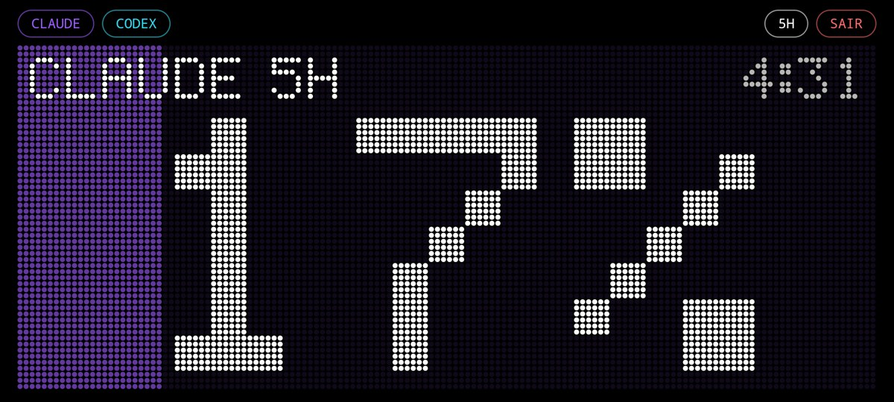
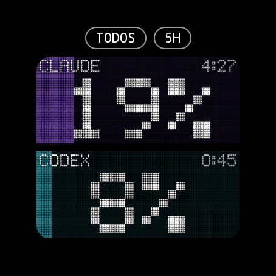
</p>

**IAs**
- **Claude Code** pela statusline do terminal (um clique: **CONECTAR** em **Ajustes → IAS**), ou pelo login, para quem usa o **painel do VS Code**.
- **Codex**: automático, pelo terminal, pelo VS Code ou pelo app do Codex.
- **GitHub Copilot**: opcional (premium requests do mês, via `gh auth token`).
- **Windsurf**: automático.
- **Cursor**: opcional (uso do mês do plano, com o login que o Cursor já guardou).
- **GLM (Z.ai), MiniMax, Kimi Code, OpenRouter, Factory Droid**: cole uma chave de API em **Ajustes → IAs** (no Mac, fica no Keychain).
- **Qualquer outra IA** com um arquivo JSON pequeno: [docs/providers.md](docs/providers.md).

**E mais**
- **Idiomas:** português e inglês, com a chave **AUTO / PT / EN** (AUTO segue o sistema).
- **Janelas:** 5 horas, 7 dias, ou as duas na mesma tela. O fundo enche com o uso: 23% acende 23% do display.
- **Avisos** quando uma janela passa de **80%** e **95%** e quando **reseta** (o iPhone espelha no relógio).
- **Personalização:** cor de cada IA, do texto e do contador, cor pelo uso, vermelho a partir de 85%, pontos redondos ou quadrados, brilho.

<p align="center">
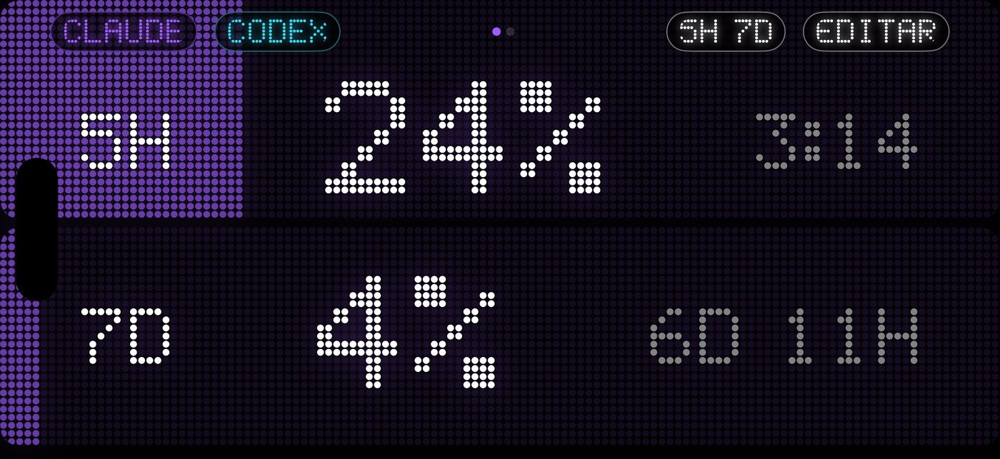
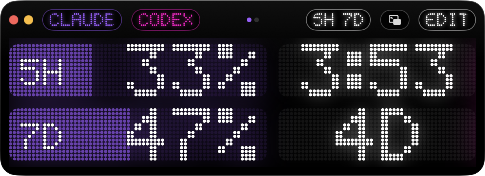
</p>
<p align="center">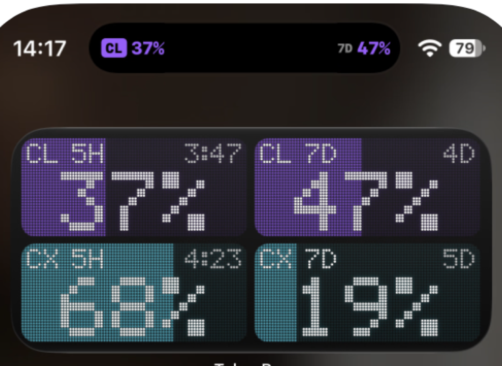</p>
<p align="center">
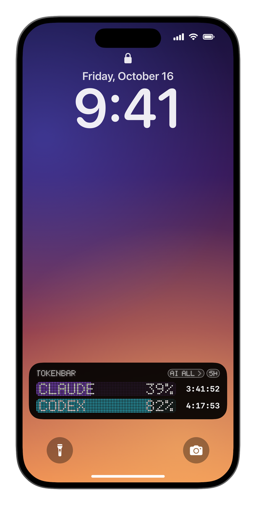
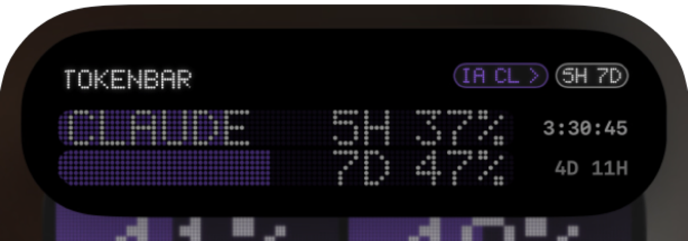
</p>
<p align="center">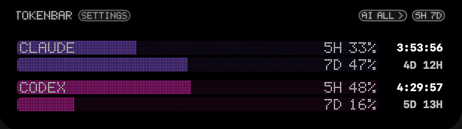</p>
<p align="center">
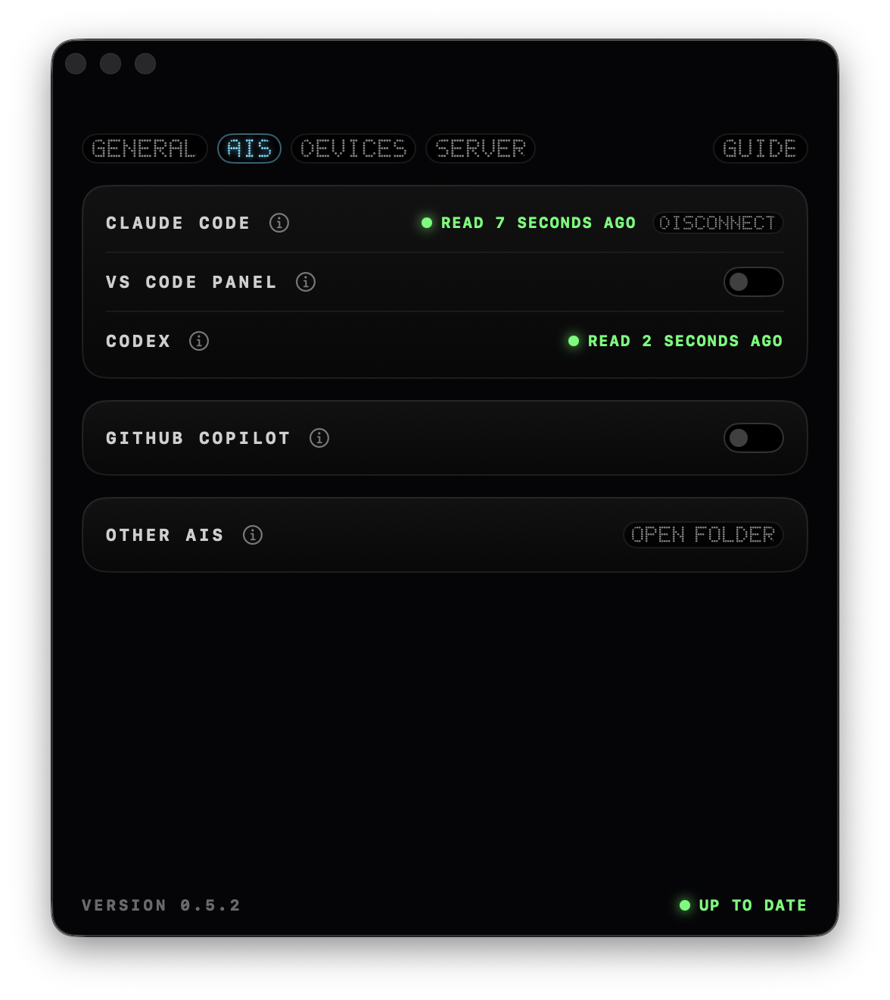
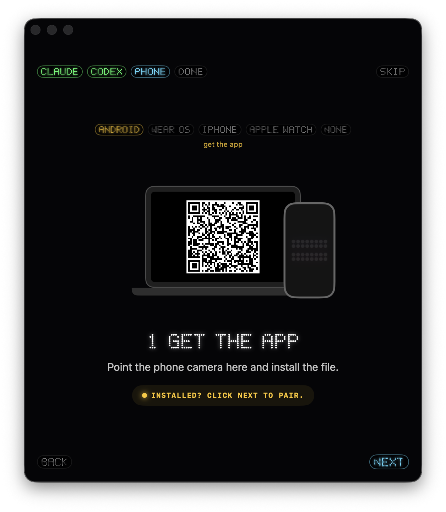
</p>
<p align="center">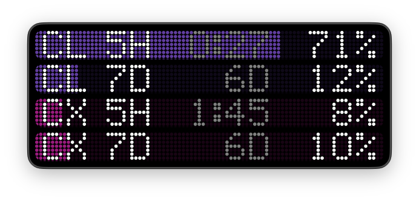</p>
<p align="center">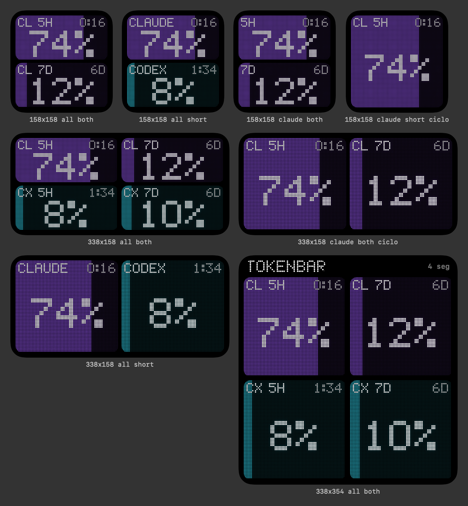</p>
<p align="center">
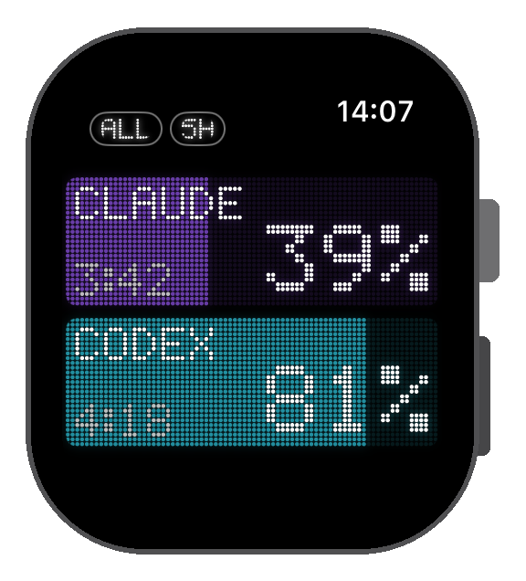
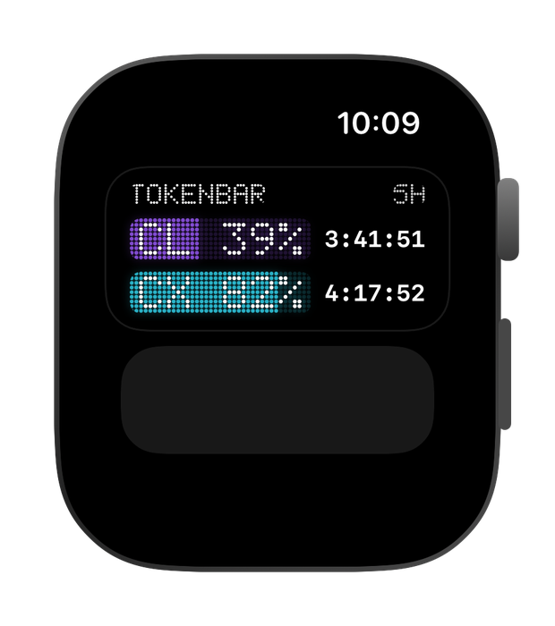
</p>

---

## API e desenvolvedores

- **API local** enquanto o app roda (Mac, Windows, Linux): `http://localhost:41777/v1/usage`, só neste computador; a porta real fica em `~/.tokenbar/api.json`.
- **CLI** `tokenbar`: barras no terminal, `tokenbar --prompt` para o prompt do shell ou o tmux, `tokenbar get claude 5h` para scripts. Funciona até sem o app.
- **Servidor MCP** `tokenbar-mcp`: o Claude Code, o Codex ou o Cursor chamam `check_budget` antes de uma tarefa longa.
- **Webhooks** em 80% / 95% / reset (Slack e Discord recebem uma frase; outros endereços, o JSON).
- `~/.tokenbar/snapshot.json` para ler sem o app, e `~/.tokenbar/providers/*.json` para incluir qualquer IA.

```sh
curl -s http://localhost:41777/v1/usage
```

Esquemas e exemplos (curl, JavaScript, Python, starship, tmux, zsh): [docs/api.md](docs/api.md).

---

## Como funciona

```
                          Wi-Fi (Bonjour)                       WatchConnectivity / Wear OS
 Computador ───────────────────────────────────► iPhone / Android ─────────────────────► Apple Watch / Wear OS
 (Mac, Windows, Linux)                             widgets, Tela Bloqueada,               complicações
  │ Claude Code: cópia da statusline (ou login)     Atividade ao Vivo
  │ Codex: ~/.codex/sessions · Windsurf · Copilot · Cursor · GLM · MiniMax · Kimi · OpenRouter · Droid
  │ qualquer IA: ~/.tokenbar/providers/*.json
  │
  └──── PUT ────► servidor (opcional) ◄── GET ── celulares e relógios, fora de casa
```

1. **O computador coleta.** O Claude Code só entrega os limites para a *statusline*; o TokenBar instala um script pequeno (`~/.tokenbar/claude-tee.sh`) que guarda uma cópia e roda a statusline que você já tinha, sem mudar nada (com backup do `settings.json`). O Codex grava os limites em `~/.codex/sessions`.
2. **Ele se anuncia na rede local** (`_tokenbar._tcp`) e só responde a aparelhos com a chave de pareamento.
3. **Os celulares acham o computador sozinhos** no mesmo Wi-Fi e repassam os números para o relógio.
4. **Servidor opcional:** o computador também manda para ele, e os celulares usam o número mais recente entre Wi-Fi e servidor.

## Privacidade

- **Nenhum código, prompt ou conversa sai do computador.** Só porcentagens, horários de reset e há quanto tempo foram lidos.
- **Wi-Fi:** o computador só responde a aparelhos que mandam a chave de pareamento; o anúncio mostra só os 8 primeiros caracteres dela.
- **API local:** escuta só em 127.0.0.1 e recusa outros cabeçalhos `Host`.
- **Logins:** o token do login do Claude Code só vai para a Anthropic; o token do GitHub (Copilot) só vai para o GitHub. Os dois são só leitura e vêm desligados.
- **Servidor:** guarda o `sha256` da chave, nunca a chave, e o último retrato do uso.
- **Quem tiver o QR vê os seus números.** Não publique.

## Limitações conhecidas

- **iPhone precisa de um Mac com Xcode**, e com conta gratuita da Apple o app vence a cada **7 dias** (renove com o `install-ios.sh`, ou `--auto`).
- **macOS:** não notarizado (veja a caixa "O Mac bloqueou?"). Não tem sandbox, então não vai para a Mac App Store.
- **Linux:** ainda sem pacote; compile do código.
- **Claude Code:** os números atualizam enquanto alguma sessão do Claude Code está rodando (statusline), a não ser que a leitura pelo login esteja ligada.
- **Endpoints não oficiais:** a leitura pelo login do Claude e o Copilot usam endpoints sem documentação pública, que podem mudar.
- **Widgets:** o iOS e o watchOS atualizam a cada ~15 minutos.

## Problemas comuns

| Sintoma | O que fazer |
|---|---|
| Celular: "Mac não encontrado no Wi-Fi" | Mesmo Wi-Fi? iPhone: **Rede Local** ligada (Ajustes → Privacidade e Segurança → Rede Local → TokenBar)? O firewall do computador libera o TokenBar? |
| Celular: "O Mac recusou a chave" | Escaneie o QR de novo. |
| O Claude não aparece | **Ajustes → IAS → CLAUDE CODE → CONECTAR** e mande uma mensagem no Claude Code pelo terminal. |
| Claude no **painel do VS Code** | A statusline não roda lá. Ligue **PAINEL DO VS CODE** em **Ajustes → IAS**, ou clique em **LIGAR** no aviso embaixo do aparelho. O macOS pergunta uma vez: Permitir Sempre. |
| O Codex não aparece | Use o Codex uma vez; os limites chegam com a primeira resposta. |
| Extensão do VS Code no Modo Restrito | Não é mais problema: a extensão roda em pastas não confiáveis. |
| Relógio: "não foi possível verificar a integridade" | Ligue o Modo de Desenvolvedor no relógio (Ajustes → Privacidade e Segurança). |
| Ícone em branco no Dock | `killall Dock`. Se continuar, reinicie o Mac. |

---

## Compilar do código

**Mac, iPhone e Apple Watch** (Xcode 26+ e `brew install xcodegen`):

```sh
git clone https://github.com/ChaconLucas/tokenbar.git && cd tokenbar
printf 'DEVELOPMENT_TEAM = ABCDE12345\nTB_BUNDLE_PREFIX = com.seunome\n' > Config/Signing.local.xcconfig   # seu Team ID; o git ignora este arquivo
xcodegen generate && open TokenBar.xcodeproj
```

Esquemas: **TokenBarMac** (Mac), **TokenBar** (iPhone, leva junto o app do relógio), **TokenBarWatch**. iPhone e relógio precisam do **Modo de Desenvolvedor**; na primeira abertura permita a **Rede Local** e pareie pelo QR em **Ajustes → APARELHOS**.

**Windows e Linux** (Rust e Node 18+; no Linux também `sudo apt install libwebkit2gtk-4.1-dev libayatana-appindicator3-dev librsvg2-dev build-essential`):

```sh
cd desktop && npm install && npx tauri build    # instaladores em src-tauri/target/release/bundle/
```

**Android e Wear OS** (JDK 17 e o Android SDK):

```sh
cd android
echo "sdk.dir=$HOME/Library/Android/sdk" > local.properties
JAVA_HOME=/opt/homebrew/opt/openjdk@17 ./gradlew :app:assembleDebug :wear:assembleDebug
adb install app/build/outputs/apk/debug/app-debug.apk                # celular
adb -s <relógio> install wear/build/outputs/apk/debug/wear-debug.apk # relógio
```

### Servidor opcional (ver os números fora de casa)

Sem servidor, os celulares só atualizam no mesmo Wi-Fi do computador. Suba o seu, grátis, na Cloudflare (Worker + D1):

```sh
cd server && npm install && cp wrangler.example.toml wrangler.toml
npx wrangler login
npx wrangler d1 create tokenbar          # copie o database_id para o wrangler.toml
npx wrangler d1 execute tokenbar --remote --file=schema.sql
npx wrangler deploy                      # mostra https://tokenbar.<sua-conta>.workers.dev
```

Cole o endereço em **Ajustes → SERVIDOR → ENDEREÇO** (Windows/Linux: ⚙) e escaneie o QR de novo no celular. O computador só manda quando o número muda, ou a cada 10 minutos.

## Estrutura

```
App/macOS    app do Mac: coletor, servidor Wi-Fi, ilha no notch, Mini, ajustes, API local, webhooks
App/iOS      app do iPhone: tela cheia, Atividade ao Vivo, guia e leitor de QR
App/watchOS  app do Apple Watch
Shared/      modelo, display de LED, tema, idiomas, cliente Wi-Fi, API do servidor
Widget/      widgets, complicações, Central de Controle e Atividade ao Vivo (Mac, iPhone, Watch)
android/     celular Android (app), Wear OS (wear) e código comum (core)
desktop/     app de Windows e Linux (Tauri)
vscode/      extensão do VS Code
raycast/     extensão do Raycast
streamdeck/  plugin do Stream Deck
cli/         CLI `tokenbar` e servidor `tokenbar-mcp`
server/      Cloudflare Worker + D1 opcional
scripts/     instaladores (Mac, iPhone, CLI) e publicação
docs/        imagens, docs da API e dos provedores
```

## Licença

MIT. Veja [LICENSE](LICENSE).

O TokenBar é um projeto independente, sem vínculo com a Anthropic, a OpenAI, o GitHub ou os criadores do Windsurf. "Claude", "Claude Code", "Codex", "Copilot" e "Windsurf" são marcas dos seus respectivos donos.
