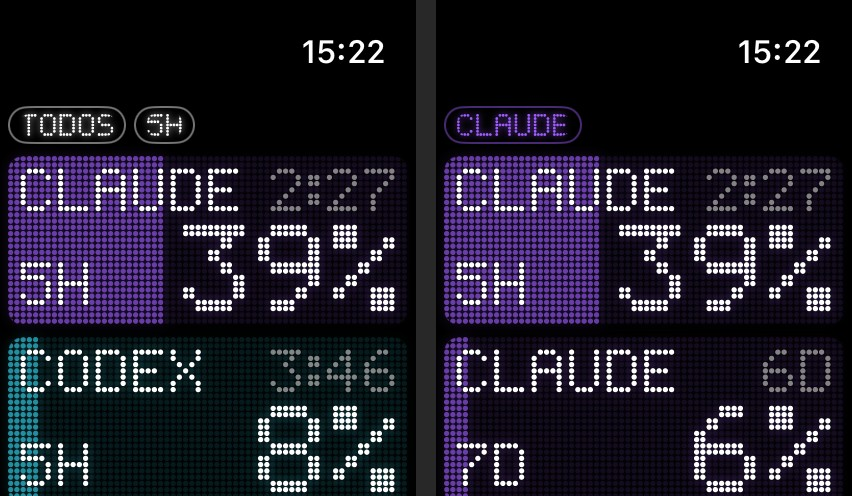

<p align="center"></p>

<h1 align="center">TokenBar</h1>

<p align="center">
Quanto você já gastou dos limites do <b>Claude Code</b>, do <b>Codex</b> (ou de qualquer IA), e quando reseta,<br>
num display de LED no Mac, Windows, Linux, iPhone, Android, Apple Watch e Wear OS.
</p>

<p align="center"></p>

[English](README.md) · **Português**

---

## Instalar

**Mac** (macOS 15+), um comando no Terminal:

```sh
curl -fsSL https://raw.githubusercontent.com/ChaconLucas/tokenbar/main/scripts/install-mac.sh | sh
```

<details>
<summary><b>O Mac bloqueou ("não pode ser aberto", "desenvolvedor não identificado", "está danificado")?</b></summary>

O TokenBar ainda não é autenticado pela Apple (isso exige a conta paga de desenvolvedor), então o macOS bloqueia a primeira abertura quando o app vem **pelo navegador**. Qualquer um destes resolve:

1. **Instale pelo comando acima.** Baixado pelo Terminal, o aviso não aparece.
2. **Libere uma vez:** tente abrir o TokenBar → **Ajustes do Sistema → Privacidade e Segurança** → role até o fim → **Abrir Mesmo Assim** → senha do Mac.
3. **"Está danificado"?** No Terminal: `xattr -dr com.apple.quarantine /Applications/TokenBar.app` e abra de novo.

O pedido *"TokenBar quer usar informações confidenciais em Claude Code-credentials"* não é bloqueio: é a leitura pelo login (painel do VS Code). Responda **Permitir sempre**.
</details>

**Ou peça para a sua IA.** Abra o Claude Code, o Codex ou outra IA com terminal e diga:

> Leia https://github.com/ChaconLucas/tokenbar/blob/main/INSTALL.md e instale o TokenBar para mim.

O [`INSTALL.md`](INSTALL.md) foi escrito para a IA: ela pergunta quais aparelhos você tem, roda os comandos e só pede a sua mão quando precisa (uma permissão, o celular, o relógio).

| Aparelho | Como |
|---|---|
| **Mac** | o comando acima |
| **Windows** | `TokenBar-Windows-setup.exe` nos [Releases](https://github.com/ChaconLucas/tokenbar/releases). Se o Windows avisar, **Mais informações → Executar assim mesmo** |
| **Linux** | por enquanto compilando (veja o `INSTALL.md`) |
| **Mac (Homebrew)** | `brew install --cask chaconlucas/tokenbar/tokenbar` |
| **Windows (winget)** | `winget install ChaconLucas.TokenBar` (em análise pela Microsoft) |
| **VS Code** | a % na barra de baixo do VS Code: procure **TokenBar** em Extensões ([loja](https://marketplace.visualstudio.com/items?itemName=chaconlucas.tokenbar)) |
| **Raycast** | a % na barra de menus do Mac e um comando no Raycast: com o [Raycast](https://raycast.com) instalado, rode `cd raycast && npm install && npm run dev` (veja o [`raycast/README.md`](raycast/README.md)) |
| **Stream Deck** | teclas com o uso da IA e a contagem até o reset (e os botões giratórios do Stream Deck +) no visual de LED: baixe `TokenBar-StreamDeck.streamDeckPlugin` nos [Releases](https://github.com/ChaconLucas/tokenbar/releases) e dê dois cliques (funciona no Stream Deck virtual, sem aparelho) |
| **Android** | `TokenBar-Android.apk` nos [Releases](https://github.com/ChaconLucas/tokenbar/releases) |
| **Wear OS** | `TokenBar-WearOS.apk` nos Releases, instalado com `adb` |
| **iPhone** | no Mac com o Xcode (grátis) e o iPhone no cabo: `curl -fsSL https://raw.githubusercontent.com/ChaconLucas/tokenbar/main/scripts/install-ios.sh | sh`. Rodar de novo atualiza e renova os 7 dias da conta gratuita da Apple |

**Atualizações:** a partir da 0.3.0, Mac, Windows e Android avisam quando sai versão nova (botão **Atualizar**). Um clique e pronto. iPhone, Apple Watch e Wear OS se atualizam instalando de novo.

**O computador é quem coleta os números.** Celular e relógio só mostram o que ele manda pelo Wi-Fi, então comece sempre por ele.

---

## O que ele faz

- **Mac:** um "aparelho" de LED na tela (dá para aumentar, diminuir e pôr em tela cheia) e, na barra de menu, mini barras de pontos de LED coloridas, uma por IA, com a %. Clicar nelas abre um resumo com o aparelho e botões de vidro (*liquid glass* no macOS 26): Aparelho, Mini, Ajustes, atualizar e sair.
- **Mini (Mac):** o aparelho pequeno, num painel flutuante (NSPanel) sempre na frente, inclusive de apps em tela cheia, e em todas as mesas (Spaces). Dá para redimensionar mantendo a proporção; posição e tamanho ficam salvos. Abre pelo botão **Mini** da barra de menu, pela tecla de destacar do aparelho (o ícone de janelinha saindo, no canto direito) ou pelo controle da Central de Controle. Para fechar, o **×** que aparece ao passar o mouse, ou clique com o botão direito → Fechar Mini.
- **Central de Controle (macOS 26 / iOS 18):** controles **TokenBar** (todas as IAs), **Claude**, **Codex**, **TokenBar flutuante** e **TokenBar aparelho**. O ícone é um anel de 12 pontos de LED que acende conforme o gasto; aumentado, o controle mostra duas linhas (a % em cima, quando reseta embaixo). A Apple só permite ícone + 2 linhas de texto, e todo controle novo entra pequeno: aumente-o uma vez para ver as linhas.
- **Windows e Linux:** o mesmo aparelho de LED, o flutuante e um anel de pontos na bandeja do sistema (app em [`desktop/`](desktop), feito com Tauri).
- **iPhone:** abre deitado, em tela cheia, com a tela sempre acesa, para usar como relógio de mesa. Tem widgets na tela inicial e na tela bloqueada.
- **Apple Watch:** um app e complicações no mostrador (anel, canto e linha). No app, a tecla **TODOS / CLAUDE / CODEX** (ou girar a coroa digital) escolhe ver todas as IAs ou só uma (com o 5H e o 7D dela), e **5H / 7D** troca a janela. As cores seguem as do iPhone. Com o servidor opcional, o relógio busca os números sozinho, sem o iPhone por perto.
- **Qualquer IA:** Claude Code e Codex prontos (terminal, VS Code ou app do Codex); qualquer outra IA por um arquivo JSON pequeno ([docs/providers.md](docs/providers.md)). Você escolhe qual aparecer e arrasta para o lado para trocar.
- **Janelas:** 5 horas, 7 dias ou as duas na mesma tela.
- **Personalização:** cor de cada IA, do texto e do tempo, pontos redondos ou quadrados, brilho e vermelho perto do limite.
- **O fundo enche conforme o gasto:** 23% acende 23% do display.
- **Avisos:** notificação (no iPhone e espelhada no relógio) ao passar de **80%** e **95%** de uma janela, e quando ela **reseta**. O iPhone atualiza em segundo plano para avisar mesmo com o app fechado (o iOS decide a frequência, em geral a cada 15–60 min).
- **Widgets:** quatro prontos na galeria — **Todas · 5h e 7d**, **Todas · 5h**, **Claude · 5h e 7d**, **Codex · 5h e 7d** — e o **Personalizado** (segure → Editar): escolha **Todas / Claude / Codex / Uma por vez** e **5h / 7d / As duas**. Em "Uma por vez", tocar no widget troca de IA sem abrir o app (iPhone e Mac). No iPhone, empilhe widgets (arraste um sobre o outro) e deslize entre eles. Pequeno, médio e grande no Mac e no iPhone; tela bloqueada e mostrador do relógio (retangular, redondo, canto e linha). No relógio, as combinações aparecem prontas na lista do mostrador.

<p align="center">


</p>
<p align="center"></p>
<p align="center"></p>

## Android e Wear OS

Para quem tem **Mac + celular Android + relógio Wear OS** (Galaxy Watch, Pixel Watch e outros). O app fica em [`android/`](android).

<p align="center">


</p>

- **Celular:** abre deitado, em tela cheia e com a tela sempre acesa. Teclas CLAUDE/CODEX e 5H/7D/5H 7D; deslizar troca de IA. Widget na tela inicial (largo = 5h e 7d de todas as IAs). Avisos de 80%, 95% e reset, com atualização em segundo plano.
- **Relógio:** funciona **com ou sem celular**. Com celular, recebe os números dele; sozinho, digite no relógio o **código de 6 números** que o Mac mostra em *Editar → Mais ajustes → RELÓGIO SEM CELULAR* (mesmo Wi-Fi). O código vale uma vez e troca a cada 10 minutos. Depois disso o relógio busca direto no Mac (Wi-Fi) ou no servidor. Teclas TODOS/CLAUDE/CODEX e 5H/7D. Complicações no mostrador.
- **Pareamento:** no Mac, *Editar → Mais ajustes*; no Android, **ESCANEAR QR** (ou cole o link).
- Lê o Mac pelo Wi-Fi (o mesmo anúncio Bonjour do iPhone) ou pelo servidor opcional.

### Baixar

Na página de [**Releases**](https://github.com/ChaconLucas/tokenbar/releases) há `TokenBar-Android.apk` (celular) e `TokenBar-WearOS.apk` (relógio). No celular, abra o `.apk` e permita "instalar apps desconhecidos"; se o Play Protect avisar, toque em **Instalar assim mesmo**. No relógio, instale com `adb` (Ajustes → Opções do desenvolvedor → Depuração por Wi-Fi). Para estar na Play Store seria preciso uma conta de desenvolvedor Google (US$ 25, paga uma vez).

**Huawei:** celulares com EMUI / HarmonyOS 2–4 instalam o `.apk`, mas sem os serviços do Google o botão "Escanear QR" não funciona — cole o link. Celulares com **HarmonyOS NEXT** e relógios Huawei (Watch GT, Watch 4/5, Watch Fit) ainda não são suportados: precisariam de um app próprio feito no DevEco Studio e de uma conta de desenvolvedor Huawei.

### Compilar

Requisitos: JDK 17 e Android SDK (`brew install openjdk@17 android-commandlinetools`).

```sh
cd android
echo "sdk.dir=$HOME/Library/Android/sdk" > local.properties
JAVA_HOME=/opt/homebrew/opt/openjdk@17 ./gradlew :app:assembleDebug :wear:assembleDebug
adb install app/build/outputs/apk/debug/app-debug.apk          # no celular
adb -s <relógio> install wear/build/outputs/apk/debug/wear-debug.apk   # no relógio (depuração por Wi-Fi ligada)
```

## Como funciona

```
                    Wi-Fi (Bonjour)                    WatchConnectivity
 Mac ─────────────────────────────────────► iPhone ─────────────────────► Apple Watch
  │ lê os limites do disco                    │ widgets e tela bloqueada     complicações
  │ Claude Code: cópia da statusline          │
  │ Codex: ~/.codex/sessions                  │
  │                                           │
  └──── PUT ────► servidor (opcional) ◄── GET ┘   fora de casa
```

1. **O Mac coleta.** O Claude Code entrega os limites (`rate_limits.five_hour` e `seven_day`) só para a *statusline*. O app instala um pequeno script (`~/.tokenbar/claude-tee.sh`) que guarda uma cópia desse JSON e repassa para a statusline que você já tinha, sem mudar nada que você vê no terminal. O Codex grava os limites nos arquivos de sessão em `~/.codex/sessions`.
2. **O Mac anuncia na rede local** (`_tokenbar._tcp`) e responde só para quem tem a chave do pareamento.
3. **O iPhone acha o Mac sozinho** no mesmo Wi-Fi, lê os números e passa para o relógio.
4. **Servidor opcional:** se você configurar um, o Mac também envia para ele, e o iPhone usa o número mais recente entre Wi-Fi e servidor. Assim funciona fora de casa.

## Requisitos

- macOS 15+ com **Xcode 26+**
- [XcodeGen](https://github.com/yonaskolb/XcodeGen): `brew install xcodegen`
- iPhone com iOS 17+ e, se quiser, Apple Watch com watchOS 10+
- Uma conta Apple (a gratuita serve para rodar nos seus próprios aparelhos; veja **Distribuição**)
- Claude Code e/ou Codex instalados no Mac

## Instalar pelo Xcode (iPhone e Apple Watch)

Para o Mac sozinho não precisa disso: use o comando do topo.

### 1. Baixar e configurar a assinatura

```sh
git clone https://github.com/ChaconLucas/tokenbar.git
cd tokenbar
```

Crie `Config/Signing.local.xcconfig` (o git ignora este arquivo) com duas linhas:

```
DEVELOPMENT_TEAM = ABCDE12345     // Xcode → Settings → Accounts → seu time → Team ID
TB_BUNDLE_PREFIX = com.seunome    // qualquer prefixo único seu
```

Gere o projeto e abra:

```sh
xcodegen generate
open TokenBar.xcodeproj
```

### 2. Mac

1. No Xcode, escolha o esquema **TokenBarMac** e rode (⌘R). O aparelho aparece na tela e a % aparece na barra de menu.
2. Clique em **EDITAR → Mais ajustes… → Conectar Claude Code**. Antes de mexer, é feito um backup em `~/.claude/settings.json.tokenbar-backup`.
3. Os números do Claude aparecem na próxima vez que uma sessão do Claude Code atualizar a statusline. Os do Codex já aparecem se você usou o Codex recentemente.

> O macOS pode perguntar se o TokenBar pode **aceitar conexões de entrada**. Responda **Permitir**: é assim que o iPhone lê o Mac pelo Wi-Fi.

Para deixar o app fixo em Aplicativos, use **Product → Archive → Distribute App → Copy App** no Xcode, ou copie `TokenBar.app` da pasta de build para `/Applications`.

### 3. iPhone

1. Conecte o iPhone e ative o **Modo de Desenvolvedor** (Ajustes → Privacidade e Segurança).
2. Escolha o esquema **TokenBar** com o seu iPhone como destino e rode. O app do relógio vai junto.
3. Na primeira abertura, **permita o acesso à Rede Local**. Sem isso o iPhone não acha o Mac.
4. No Mac, em **EDITAR → Mais ajustes…**, aponte a câmera do iPhone para o **QR code** e toque em **Abrir no TokenBar**.
5. Se o iOS disser que o desenvolvedor não é confiável: Ajustes → Geral → VPN e Gerenciamento de Dispositivos → confiar.

### 4. Apple Watch

1. No relógio: **Ajustes → Privacidade e Segurança → Modo de Desenvolvedor → ligar** (ele reinicia).
   Se a opção não aparecer, abra o Xcode em **Window → Devices and Simulators** com o relógio desbloqueado e perto do iPhone.
2. No iPhone: app **Watch → Meu Relógio → TokenBar → Instalar**.
3. O relógio recebe o pareamento e os números pelo iPhone. Não precisa configurar nada nele.

> **"Não foi possível instalar porque a integridade não pôde ser verificada"** = o Modo de Desenvolvedor está desligado no relógio, ou o relógio ainda não foi registrado no seu time. Ligue o modo e rode o esquema **TokenBarWatch** uma vez com o relógio como destino.

### 5. Widgets

- **iPhone:** segure o dedo na tela inicial ou na tela bloqueada → **+** → TokenBar.
- **Watch:** segure o mostrador → Editar → complicações → TokenBar.
- **Mac:** clique com o botão direito na mesa → Editar Widgets → TokenBar.
- **Central de Controle (macOS 26 / iOS 18):** editar a Central de Controle → adicionar controle → TokenBar. Aumente o controle uma vez para ver as duas linhas.

### Distribuição

- **Conta Apple gratuita:** os apps instalados no iPhone e no relógio expiram em **7 dias**. Para renovar, rode de novo pelo Xcode.
- **Conta paga (US$ 99/ano):** dá para distribuir pelo TestFlight ou pela App Store.
- **Android:** os `.apk` ficam nos [Releases](https://github.com/ChaconLucas/tokenbar/releases) (veja **Android e Wear OS → Baixar**).

## API e desenvolvedores

Os números do TokenBar podem ir para os seus scripts e agentes:

- **API local** enquanto o app está aberto: `curl http://localhost:41777/v1/usage` (só neste computador; a porta real fica em `~/.tokenbar/api.json`).
- **CLI** `tokenbar` (Node 18+): barras no terminal, `tokenbar --prompt` para o prompt do shell ou o tmux, `tokenbar get claude 5h` para scripts. Funciona mesmo sem o app.
- **Servidor MCP** `tokenbar-mcp`: o Claude Code, o Codex ou o Cursor chamam `check_budget` antes de uma tarefa longa.
- **Webhooks** em 80% / 95% / reset (Slack, Discord, Home Assistant…) e `~/.tokenbar/providers/*.json` para acrescentar qualquer IA.

```sh
curl -fsSL https://raw.githubusercontent.com/ChaconLucas/tokenbar/main/scripts/install-cli.sh | sh
```

Tudo (formatos e exemplos em curl, JavaScript, Python, starship, tmux, zsh): [docs/api.md](docs/api.md).

## Servidor opcional (ver fora de casa)

Sem servidor, o iPhone só atualiza quando está no mesmo Wi-Fi que o Mac; fora dele, mostra o último número. Para atualizar de qualquer lugar, suba o seu servidor gratuito na Cloudflare (Worker + D1):

```sh
cd server
npm install
cp wrangler.example.toml wrangler.toml
npx wrangler login
npx wrangler d1 create tokenbar          # copie o database_id que aparecer para wrangler.toml
npx wrangler d1 execute tokenbar --remote --file=schema.sql
npx wrangler deploy                      # mostra https://tokenbar.<sua-conta>.workers.dev
```

Depois, no Mac: **EDITAR → Mais ajustes… → Servidor**, cole o endereço, **SALVAR** e escaneie o QR de novo no iPhone.

O plano gratuito da Cloudflare permite 100 mil gravações por dia. O Mac só envia quando o número muda, ou a cada 10 minutos como sinal de vida.

## Privacidade

- **Nada de código, prompt ou conversa sai do Mac.** Só porcentagens, horários de reset e há quanto tempo foram lidos.
- **No Wi-Fi:** o Mac só responde a quem envia a chave do pareamento. O anúncio na rede mostra só os 8 primeiros caracteres dela, para o iPhone saber qual Mac é o seu.
- **No servidor:** ele guarda o `sha256` da chave, nunca a chave, e o último retrato de uso.
- **Quem tem o QR code vê os seus números.** Não publique.

## Limitações conhecidas

- **Claude Code:** os números só atualizam enquanto alguma sessão do Claude Code está aberta, porque é ela que alimenta a statusline. O display mostra há quanto tempo o número foi lido.
- **Widgets:** o iOS e o watchOS limitam a atualização dos widgets a mais ou menos a cada 15 minutos. Sem servidor, o widget do iPhone mostra o que o app leu da última vez que esteve aberto.
- **Depois do reset:** a barra volta a 0% sozinha, mesmo antes de chegar número novo.
- **App Store:** o app do Mac não usa sandbox (precisa ler `~/.codex` e `~/.claude`), por isso não é distribuível pela Mac App Store.

## Problemas comuns

| Sintoma | O que fazer |
|---|---|
| iPhone diz "Mac não encontrado no Wi-Fi" | Mesmo Wi-Fi? Permissão de **Rede Local** ligada (Ajustes → Privacidade → Rede Local → TokenBar)? Firewall do Mac permitindo o TokenBar? |
| iPhone diz "O Mac recusou a chave" | Escaneie o QR de novo. |
| Claude não aparece | Clique em **Conectar Claude Code** e mande uma mensagem no Claude Code **pelo terminal**. Usa o **painel do VS Code**? Ali a statusline não roda: use `claude` no terminal do VS Code ou ligue **Ler pelo login do Claude Code** em Ajustes (o macOS pergunta uma vez: Permitir sempre). |
| Codex não aparece | Use o Codex uma vez. Os limites aparecem nos arquivos de sessão depois da primeira resposta. |
| Relógio: "integridade não pôde ser verificada" | Veja **Instalar → Apple Watch**. |
| Ícone em branco no Dock | `killall Dock`. Se continuar, reinicie o Mac (cache de ícones do macOS). |

## Estrutura

```
App/macOS     coletor (Claude/Codex), servidor Wi-Fi (Bonjour), janela, barra de menu, ajustes
App/iOS       app em tela cheia, busca Wi-Fi + servidor, repassa ao relógio
App/watchOS   app do relógio (recebe do iPhone)
Shared/       modelo, display de matriz de pontos, tema, cliente Wi-Fi, API do servidor
Widget/       widgets e complicações (um código para Mac, iPhone e Watch)
server/       Cloudflare Worker + D1 (opcional)
Config/       assinatura (Signing.xcconfig + o seu Signing.local.xcconfig)
scripts/      gerador do ícone
```

## Licença

MIT. Veja [LICENSE](LICENSE).

TokenBar é um projeto independente e não tem ligação com a Anthropic nem com a OpenAI. "Claude", "Claude Code" e "Codex" são marcas dos seus donos.
